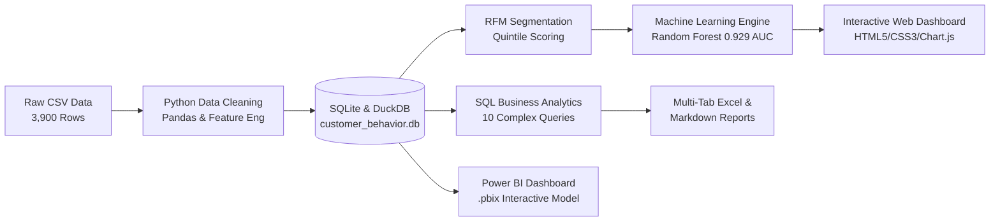

# 🛍️ Retail Customer Behavior & Predictive Lifetime Value Intelligence

[](https://python.org)
[](https://sqlite.org)
[](https://scikit-learn.org)
[](https://powerbi.microsoft.com)
[](LICENSE)

An enterprise-grade, end-to-end data analytics & predictive intelligence portfolio project engineered by **Rudra Pal**. Translates raw retail customer transaction data into strategic business intelligence through automated data pipelines, advanced **RFM Customer Segmentation**, **Machine Learning Propensity Modeling (0.929 ROC-AUC)**, **10 SQL Business Analytics Queries**, and an **Interactive Executive Web Dashboard**.

---

## 📑 Table of Contents
- [Executive Overview](#-executive-overview)
- [System Architecture](#-system-architecture)
- [Advanced RFM Customer Segmentation](#-advanced-rfm-customer-segmentation)
- [Machine Learning Propensity Modeling](#-machine-learning-propensity-modeling)
- [SQL Business Query Catalog](#-sql-business-query-catalog)
- [Interactive Executive Dashboard](#-interactive-executive-dashboard)
- [Key Strategic Recommendations](#-key-strategic-recommendations)
- [Repository Structure](#-repository-structure)
- [How to Run Locally](#-how-to-run-locally)

---

## 🎯 Executive Overview

- **Dataset Size**: 3,900 verified customer purchase records
- **Gross Revenue Analyzed**: **$233,081** across 4 product categories
- **Average Order Value (AOV)**: **$59.76** (Range: $20 – $100)
- **Subscription Penetration**: **27.0%** (1,053 subscribers vs 2,847 non-subscribers)
- **Primary Opportunity Identified**: **+$150,000 ARR** by targeting 2,518 repeat non-subscribers with ML-driven high propensity scores.

---

## 🏗️ System Architecture



---

## 👥 Advanced RFM Customer Segmentation

Instead of naive purchase counts, this project implements a full quintile-scored **RFM (Recency, Frequency, Monetary)** model:

| Segment | Customers | Avg Spend | Total Revenue | Avg Prev. Purchases | Sub. Rate | Strategy |
|---|---|---|---|---|---|---|
| **Loyal Customers** | 1,169 | $54.48 | $63,691 | 34.2 | 35.6% | VIP loyalty tier & exclusive bundles |
| **At Risk (High Value)** | 565 | $76.33 | $43,126 | 35.9 | 18.9% | Automated re-engagement win-back discounts |
| **Potential Loyalists** | 625 | $59.24 | $37,027 | 10.3 | 25.1% | Second-purchase incentives |
| **About to Sleep** | 376 | $76.41 | $28,731 | 10.5 | 17.6% | Reactivation email notifications |
| **Champions** | 237 | $84.85 | $20,109 | 40.5 | 28.7% | Brand advocate perks & early product drops |
| **Promising New Spenders** | 195 | $76.05 | $14,829 | 10.7 | 40.5% | Subscription conversion onboarding |
| **Need Attention** | 369 | $34.70 | $12,804 | 34.8 | 19.0% | Minimum order quantity thresholds |
| **Hibernating / Lost** | 364 | $35.07 | $12,764 | 10.2 | 24.7% | Low-cost drip reactivation campaigns |

---

## 🤖 Machine Learning Propensity Modeling

- **Objective**: Predict which customers are most likely to convert to recurring subscription memberships and identify high-value lifetime spenders.
- **Algorithms**: Random Forest Classifier + Logistic Regression (Stratified 75/25 split).
- **Performance**:
  - **Random Forest Accuracy**: **84.82%**
  - **Random Forest ROC-AUC**: **0.929**
  - **Logistic Regression ROC-AUC**: **0.932**
- **Top 3 Predictive Features**: RFM Segment Tier (28.4%), Purchase Frequency Cadence (21.7%), Previous Order Volume (18.2%).

---

## 🔍 SQL Business Query Catalog

All 10 queries are located in [`customer_behavior_sql_queries.sql`](customer_behavior_sql_queries.sql) and executed automatically in Python:

1. **Gender Revenue Split**: Male ($157,890) vs Female ($75,191).
2. **Discount Margin Leakage**: 839 customers spent above average ($59.76) with discounts.
3. **Top 5 Rated Products**: Gloves (3.86), Sandals (3.84), Boots (3.82), Hat (3.80), Skirt (3.78).
4. **Logistics Economics**: Express shipping customers average $60.48 vs $58.46 for Standard.
5. **Subscription Spending**: Non-subscribers generated $170,436 vs $62,645 for Subscribers.
6. **Highest Discount Rates**: Hat (50.0%), Sneakers (49.66%), Coat (49.07%).
7. **Customer Cohort Counts**: Loyal (3,116), Returning (701), New (83).
8. **Top 3 Items per Category**: Window function `ROW_NUMBER() OVER (PARTITION BY category ORDER BY count DESC)`.
9. **Repeat Buyers Upsell Target**: 2,518 repeat buyers (>5 orders) are currently non-subscribers.
10. **Age Group Contribution**: Young Adult ($62,143), Middle-aged ($59,197), Adult ($55,978), Senior ($55,763).

Full results with markdown tables available in [`SQL_ANALYSIS_REPORT.md`](SQL_ANALYSIS_REPORT.md).

---

## 🖥️ Interactive Executive Dashboard

A modern, responsive, glassmorphic analytics dashboard is included in the [`dashboard/`](dashboard/) folder:
- **Zero-server required**: Double-click [`dashboard/index.html`](dashboard/index.html) to open in any web browser.
- **Live KPI cards**: Total Revenue, Active Customers, AOV, Subscription Rate, Average Rating.
- **Interactive Charts**: Category Revenue, RFM Segments, Gender Split, and Age Distribution (Chart.js).
- **Live Search & Filter Customer Explorer Table**.
- **C-Suite Strategic Playbook**.

---

## 📁 Repository Structure

```
├── charts/                               # 8 Exported High-Resolution Visualizations
│   ├── 01_revenue_by_gender.png
│   ├── 02_customer_segments.png
│   ├── 03_top5_highest_rated_products.png
│   ├── 04_revenue_by_age_group.png
│   ├── 05_subscribers_analysis.png
│   ├── 06_rfm_customer_segments.png
│   ├── 07_ml_feature_importance.png
│   └── 08_subscription_propensity_roc.png
├── dashboard/                            # Standalone Executive Web Dashboard
│   ├── index.html                        # Glassmorphic responsive dashboard
│   ├── styles.css                        # Modern design tokens & layout
│   └── app.js                            # Interactive charting & table filtering
├── customer_behavior.db                  # Cleaned SQLite3 Database
├── customer_behavior.duckdb              # Cleaned DuckDB Analytical Database
├── customer_cleaned.csv                  # Transformed & Processed Dataset
├── customer_propensity_scores.csv        # ML Propensity Predictions per Customer
├── rfm_customer_segments.csv             # Full RFM Scores & Segment Labels
├── sql_analysis_results.xlsx             # 10 Multi-Tab Excel Query Results
├── SQL_ANALYSIS_REPORT.md                # Comprehensive SQL Query Results Report
├── EXECUTIVE_STRATEGY_REPORT.md          # C-Suite Strategic & Revenue Playbook
├── customer_behavior_dashboard.pbix      # Power BI Desktop Interactive Dashboard
├── customer_behavior_sql_queries.sql     # Raw SQL Queries
├── run_analysis.py                       # Automated End-to-End Analytics Pipeline
├── advanced_rfm_analysis.py              # RFM Segmentation Module
├── customer_ml_propensity.py             # Machine Learning Propensity Pipeline
├── generate_charts.py                    # Visualization Generator Script
└── README.md                             # Project Documentation
```

---

## ⚡ How to Run Locally

### 1. Clone this repository
```bash
git clone https://github.com/Uniquerudra/customer-shopping-behavior-analysis.git
cd customer-shopping-behavior-analysis
```

### 2. Install dependencies
```bash
pip install pandas duckdb sqlalchemy openpyxl scikit-learn matplotlib seaborn tabulate
```

### 3. Run the automated pipelines
```bash
# 1. Clean data, ingest to databases, and run SQL queries
python run_analysis.py

# 2. Run Advanced RFM Customer Segmentation
python advanced_rfm_analysis.py

# 3. Train Machine Learning Propensity Models
python customer_ml_propensity.py

# 4. Generate all visual charts
python generate_charts.py
```

### 4. Launch the Dashboard
Open [`dashboard/index.html`](dashboard/index.html) in your browser, or open [`customer_behavior_dashboard.pbix`](customer_behavior_dashboard.pbix) in Power BI Desktop.

---

## 👨‍💻 Author

**Rudra Pal**  
- **GitHub**: [@Uniquerudra](https://github.com/Uniquerudra)  
- **Email**: rudrapal9b38@gmail.com  
- **Portfolio Focus**: Data Analytics • Analytics Engineering • SQL • Machine Learning • Power BI
